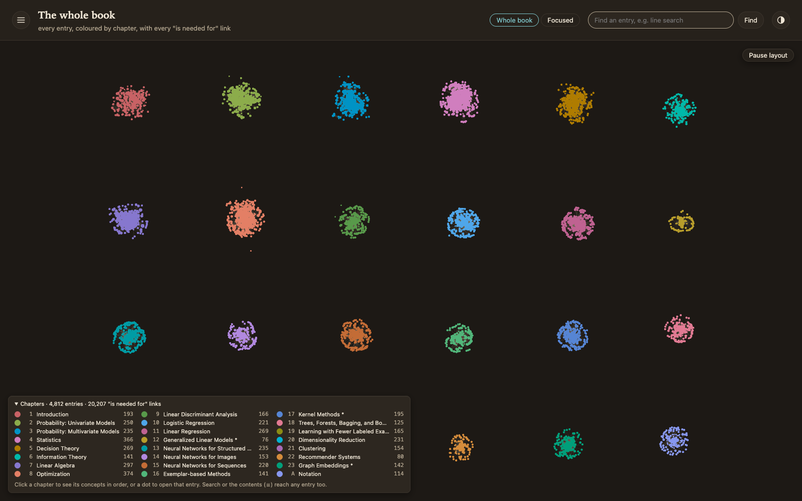

## Why I built it

A textbook's concept maps already existed, one per chapter. Each map lists the chapter's ideas and what each idea needs. But they were separate Markdown files, thousands of lines each. I wanted one graph of the whole book, so I could pick any idea and walk back to what you have to learn first.

## How I built it

The source is a set of concept maps for Kevin P. Murphy's *Probabilistic Machine Learning: An Introduction*: 23 chapters and Appendix A. AI agents wrote them in a separate run. One agent wrote each map and a second reviewed every entry. An entry is either a taught concept or a background note. Each prerequisite row says what is needed, for which part, on what basis, and whether the book states it or the readers inferred it.

A TypeScript parser reads all 24 maps and writes the book as an RDF graph in JSON-LD, one file per chapter. Every entry and every row keeps the map file and line it came from. A second check recounts everything from the map text by a different method. The counts match the book's own statistics in every chapter: 4,812 entries, 20,207 prerequisite rows and 17,913 other relation rows.

The graph is loaded into Oxigraph, a SPARQL database, running in Docker. For Murphy that is 2,040,765 triples. The files stay the real record and the database holds a copy.

The page has two views:

- **Focused.** It opens on one entry, Exact line search (Chapter 8), with the entries it needs laid out left to right. You can bring in what a card needs or what needs it, search by name, or browse the book by chapter and section. The sidebar shows the concept map's notes for the selected card, with the maths typeset.
- **Whole book.** Every entry is a dot coloured by chapter and every prerequisite row is a line. The 24 chapters settle into separate islands, because no prerequisite row crosses a chapter.

A third tab, "Ask the tutor", answers questions about the selected entry. It is Claude (claude-opus-5-5, through the Claude Agent SDK). It starts from the concept map's notes, marks anything from its own knowledge as "Beyond the notes", and can read the graph only through three read-only tools.

<figure>

<figcaption>The whole book. 4,812 entries and 20,207 prerequisite links. Each chapter forms its own island.</figcaption>
</figure>

## The hard part

Getting the numbers to agree. Three early parsers counted 20,207, 20,208 and 20,210 prerequisite rows. The differences turned out to be scan mistakes, not the book: HTML comments that looked like table rows, and one digest row full of escaped `|` characters. The final parser skips both and matches the book's statistics in every chapter.

The first full build had a quieter bug. Every citation's identifier contained a `>` character. The project's own checker passed, because it treated identifiers as plain strings. A strict RDF parser silently dropped all of them and read zero citations. Comparing counts caught it. Now the checker tests that identifiers are legal, and the RDF check stops as soon as what it read differs from the index.

The focused view had a layout problem too. After bringing in everything around Exact line search, 18 cards and 51 arrows, the picture was a tangle. Long arrows now run through gaps between the columns. Lines crossing unrelated cards went from 75 to 0.

## What I did

- I directed AI agents to build it. One agent proposed the architecture and reviewed the work; others wrote the pipeline, the database setup and the page.
- I accepted the architecture on 11 October 2026, and made the product calls: React Flow for the page, the "Paper" look and a dark version of it, the sidebar layout, and keeping Oxigraph as the database instead of switching.

## Where it stands

It runs on my own machine. The repository is private and nothing is deployed.

The viewer runs on Murphy only. The same pipeline has built and checked graphs for twelve more books, including Boyd's *Convex Optimization*, Deisenroth's *Mathematics for Machine Learning*, Sutton and Barto's *Reinforcement Learning* and Bear's *Neuroscience*. Eleven pass the count check. Sutton and Barto is off by one row, because one table cell contains an unescaped `|`. Three of the books are only partly mapped so far.

Two things are built but not in the page yet: 20 reviewed "is narrower than" links between Chapters 4 and 8, and 10 reviewed links to Wikidata.
