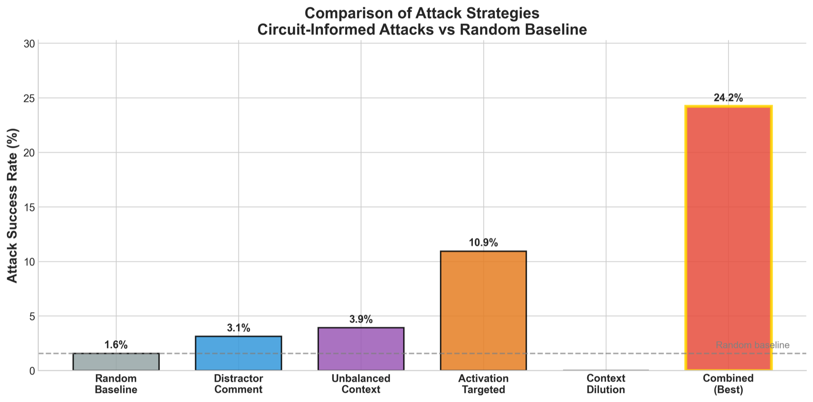

## Why I built it

OpenAI released weight-sparse language models where you can trace which neurons fire for a specific feature. I read the paper and wanted to know if that cuts both ways. If you can see how a model makes a decision, can you also see how to break it? Interpretability is supposed to make AI safer, so that is an AI safety question.

I also had a short math result about functions that flip sign under a symmetry. It bounds how far any point sits from the place where the function is zero. A model choosing between `]]` and `]` has that shape: the gap between the two logits flips sign when you swap them. I wanted to see if that bound could tell me, before attacking, which inputs an attack could flip.

## How I built it

I combined Lipschitz continuity bounds with the symmetry structure of sparse circuits. That gives a lower bound on how far an input sits from the decision boundary, and a per-family "directional budget" that says which way an attack has to push.

Then I tested the predictions on OpenAI's interpretable sparse circuits, on two independent tasks: bracket matching (estimated L ≈ 3.04) and quote matching (L ≈ 1.35). I predicted which inputs were vulnerable first and attacked second.

The two models are OpenAI's csp_yolo2 (475M parameters) for brackets and csp_yolo1 (159M) for quotes, with 32 code samples per task. On the bracket task I compared random token changes against five circuit-informed strategies: distractor comments, unbalanced context, activation-targeted edits, context dilution, and all of them combined.

<figure>

<figcaption>Circuit-informed attacks against a random baseline. The combined strategy succeeds 24.2% of the time against 1.6% for random.</figcaption>
</figure>

I also computed a certified Lipschitz bound straight from the model weights, by chaining the spectral norms of every layer. It holds, but it is very loose: about 2.3 × 10¹¹ for the bracket model, against the measured 3.04. So the paper labels every claim as proved, calibrated or observed.

I used AI agents to stress-test the work. A judge agent read the theory, code and draft, and listed seven weak spots a science fair judge would probe. Two builder agents, one on the math and one on the experiments, proposed fixes. The judge merged them over three rounds, and the builders drafted the revised paper sections.

## The hard part

It started as a narrower question: are attacks aimed at a known circuit more efficient than random ones? They were. The hard part was getting the theory to explain why.

My first version of the theorem was incomplete. It worked from margin alone, and margin alone didn't sort the inputs. Every successful attack hit a sample that predicted `]`. Samples that predicted `]]` were never flipped. So direction had to be part of the rule, and that became the directional version of the principle.

The review found deeper gaps. The symmetry I used just swapped the two output logits, so the bound held in logit space, not on the tokens an attacker actually changes. I restated it on token sequences, with distance counted as the number of tokens swapped, and proved the bound there.

The quote task gave a correlation with the wrong sign: r = +0.37, where the bracket task gave r = −0.60. That looked like it broke the theory. It turned out the quote model is lopsided. Attacks pushing `"` toward `'` worked 13.4% of the time. Attacks the other way never worked. I added a separate per-edit budget for each direction, which explains the sign without breaking the bound.

Two claims didn't survive. I had said a local sensitivity measure separated the false positives perfectly, but I had measured it from the same attacks it was sorting. I dropped that claim and designed a probe that measures it before attacking. And the 16× efficiency figure became 15.5× (95% CI 11.2× to 19.8×) once I reran the random baseline over ten seeds.

## What I did

- The theory: the distance bound and the directional budget. The underlying collision result is its own short note.
- All of the experiment code, data and figures in the repo.
- The paper and the presentation, including the poster.

## Where it stands

The code and data are public, along with the final paper and poster. Some parts are still open. The probe that measures local sensitivity before an attack has only been checked after the fact; the forward test hasn't been run. The certified bound is more than ten orders of magnitude looser than the measured one. The margin-based filter hasn't been tested against an attacker who knows it is there.
