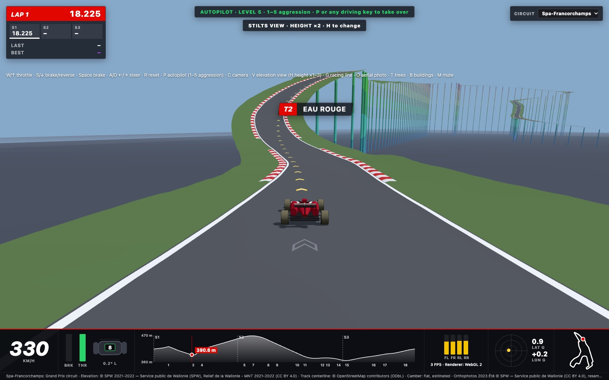

## Why I built it

I wanted to know if you can learn a circuit's hills by driving it, the way a driver learns that Eau Rouge is a wall and Raidillon a blind crest.

## How I built it

The road comes from public survey data. OpenStreetMap gives the centreline. Wallonia's LiDAR terrain model (0.5 m cells) gives the height under it at Spa, and Rhineland-Palatinate's 1 m terrain model gives it at the Nürburgring. A bake script samples heights along the centreline and sweeps a flat road cross-section across it. The renderer and the physics engine use the same triangles, so what you see is what the tyres touch. The ground around the road is a constrained Delaunay triangulation, with aerial photos, trees and buildings on top.

The car is a Rapier ray-cast vehicle stepped at 120 Hz, with per-wheel spin and slip, downforce and drag. There are two modes. Accessible is forgiving. Simulation gives each tyre one shared friction budget, so grip spent braking is grip the corner no longer has.

An autopilot drives the lap at six skill levels. Every level follows one shared reference racing line. For Spa, that line comes from a minimum-curvature quadratic program (TUM's `opt_min_curv`, solved with OSQP):

- The line is the centreline moved sideways by an offset α at each knot, 8 m apart.
- Curvature κ of the spline through those points is linearised in α. Then the objective, the sum of κ², is quadratic in α.
- Each α is bounded by the road's half-width minus a 2.55 m margin. That makes it a QP.
- The linearisation is only good near the current path. So the QP is re-solved about each new path. A step is kept only if the true ∫κ² ds of the refitted spline goes down. Otherwise the step is halved.

On Spa it converged in 11 passes. Total curvature fell from 0.61 to 0.45 per metre, and the line stays at least 2.38 m inside the road edge. Minimum curvature stands in for minimum lap time. It is not proven to be the fastest line.

<figure>

<figcaption>The stilts view (V) hangs the lap above its lowest point, here with heights stretched ×2. Only the drawing is stretched. Physics and timing stay in true metres.</figcaption>
</figure>

I built it by directing AI coding agents. I set what the product should do, drove it, and reported what felt wrong. The agents wrote the code. A separate Codex agent reviewed every slice before it merged.

## The hard part

Making the car physically honest. Driving it, I noticed that near-record laps felt too easy. Measured on a flat test pad, the car pulled about 19 g sideways at 300 km/h. The grip setting acted like a friction coefficient of about 5. Pirelli puts Silverstone's fast corners at more than 5 g. The fix in Simulation was one friction circle per tyre with μ = 1.8, a labelled assumption. That brought it to 6.65 g at 300 km/h.

Realistic grip then made the autopilot spin at the top of Raidillon. Part of the cause was the road itself. At 331 km/h the compression at the bottom of Eau Rouge adds about 1.7 to 1.9 g of load, and the crest takes much of it away. The speed planner had assumed a flat road. Part was a steering bug: it turned heading change into curvature by dividing by 16 m, but on the inside of La Source those samples spanned only 10.1 m. With curvature from the real arc length and two companion fixes, the car stays within 2.7 m of its line at La Source, down from 12.9 m.

Some gaps are still open. Braking stops about a quarter shorter than Brembo's figures for Spa. The tyres were not weakened just to match a stopwatch.

## What I did

- Set the goal and the scope: real elevation, two circuits, an Accessible mode and a Simulation mode, one shared racing line for every level.
- Drove it and reported what felt wrong, for example steering on locked wheels and near-record laps that came too easily.
- Made the design calls, such as how the racing-line chevrons should look. That took seven rounds of feedback.

## Where it stands

Both circuits drive with clean autopilot laps in Simulation mode. On Spa it laps in 108.7 s, against Norris's 2025 pole of 1:40.562. Corner speeds don't match the real lap yet. The plan is to use it as the platform for a research project: a Lean-checked guardian that keeps an AI learner able to brake in time for La Source. It is a plan with no results yet.
