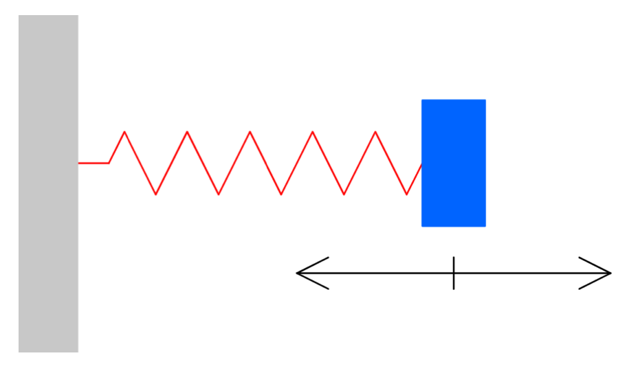

## Why I built it

I wrote this paper in Euler Circle's Independent Research and Paper Writing program in summer 2024. Each student picks a topic, studies it in depth and writes an expository paper. I picked stability analysis.

## How I built it

A dynamical system is a rule for how a state changes over time: ẋ = f(x, t). The state x is a vector, such as a position and a velocity. The paper asks one question about it. If the system sits at an equilibrium and gets nudged, does it come back?

An equilibrium, or fixed point, is a state x* where f(x*) = 0. I used the ε–δ definitions. A fixed point is stable if starting close enough keeps the state close for all time. It is asymptotically stable if, in addition, the state converges back to x*.

**Linear systems.** For ẋ = Ax, I tried solutions of the form x(t) = e^(λt) v. Substituting gives Av = λv, so the solutions come from the eigenvalues and eigenvectors of A. With distinct eigenvalues, the general solution is a sum of terms cᵢ e^(λᵢt) vᵢ. Each term has size e^(Re λᵢ · t). So if every eigenvalue has a negative real part, every term decays, and the fixed point is asymptotically stable. I proved that theorem in the paper. For a 2×2 matrix the eigenvalues solve λ² − τλ + Δ = 0, where τ is the trace and Δ is the determinant.

**Nonlinear systems.** Most real systems are not linear. Near a fixed point, a Taylor expansion gives u̇ ≈ J(x*) u, where u = x − x* is the small perturbation and J is the Jacobian, the matrix of partial derivatives of f. That is a linear system again, so the same eigenvalue test applies. The paper cites the Hartman–Grobman theorem for why this local picture can be trusted, without proving it.

**Adding control.** A controlled linear system is ẋ = Ax + Bu, where u is an input I get to choose. With feedback u = −Kx, the system becomes ẋ = (A − BK)x. The job is to pick K so that every eigenvalue of A − BK is negative.

<figure>

<figcaption>The spring-mass-damper example. Figure 1 of my paper, page 12.</figcaption>
</figure>

My first worked example is a spring-mass-damper with m = 1, k = 2 and a negative damping coefficient, b = −3. That gives A = [[0, 1], [−2, 3]] and B = [0, 1]ᵀ. Without control, its eigenvalues are 1 and 2. Both are positive, so the oscillation grows. With K = (k₁, k₂), the characteristic equation of A − BK is λ² + (k₂ − 3)λ + (k₁ + 2) = 0. I chose target eigenvalues −2 and −5, which means matching λ² + 7λ + 10. That gives K = (8, 10), and the controller u = −(8, 10)x makes the system stable.

The second example linearizes a nonlinear controlled system, ẋ₁ = x₁² + x₂ + u and ẋ₂ = x₁ + sin(x₂), at the origin. Taking Jacobians with respect to the state and the input gives A = [[0, 1], [1, 1]] and B = [1, 0]ᵀ.

**The cart-pole.** The paper ends with the classic control problem: balance a pole upright on a cart that can only move left and right. The state is (x, ẋ, θ, θ̇), the cart's position and velocity and the pole's angle and angular velocity. Near upright I used sin θ ≈ θ and cos θ ≈ 1, and dropped higher-order terms like θ̇²θ. That turns the equations of motion into a 4×4 linear system ẋ ≈ Ax + Bu. From there the controller has the same shape as before, u = −Kx, now with four gains.

## The hard part

The cart-pole is where I stopped being able to do everything by hand. I set up u = −Kx for the four-state model, but I did not solve for the four gains. In the paper I wrote that the 4×4 determinant is tedious by hand and pointed to numerical methods instead.

## What I did

- Chose the topic and wrote the paper, 19 pages, typeset in LaTeX.
- Wrote out the proofs in it: that sums of solutions are solutions, and that eigenvalues with negative real parts make a linear system's fixed point asymptotically stable. The results are standard. The paper is expository.
- Worked the examples: pole placement for the spring-mass-damper, linearizing a nonlinear controlled system, and the linear cart-pole model.

## Where it stands

The paper is finished and public in my Euler Circle repository. It closes with Lyapunov's direct method as future work: a way to prove stability without linearizing. I did not cover it in the paper.

